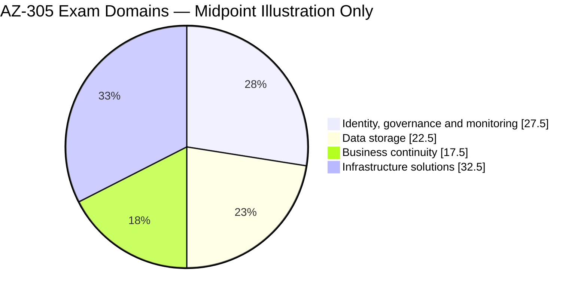
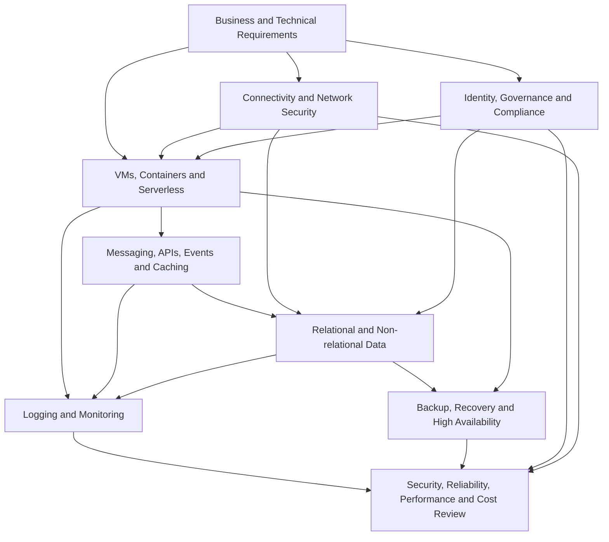
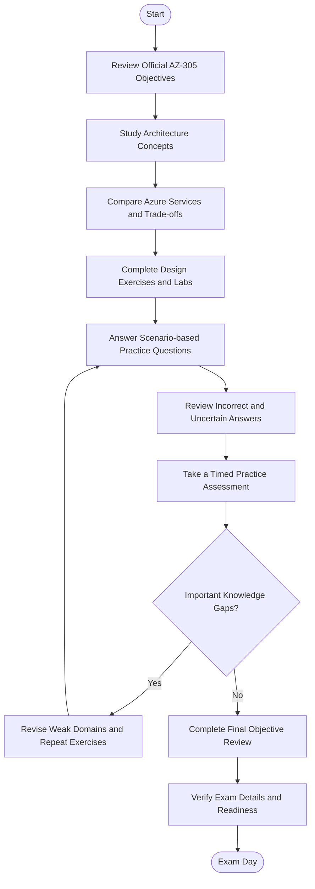
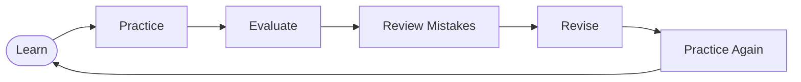
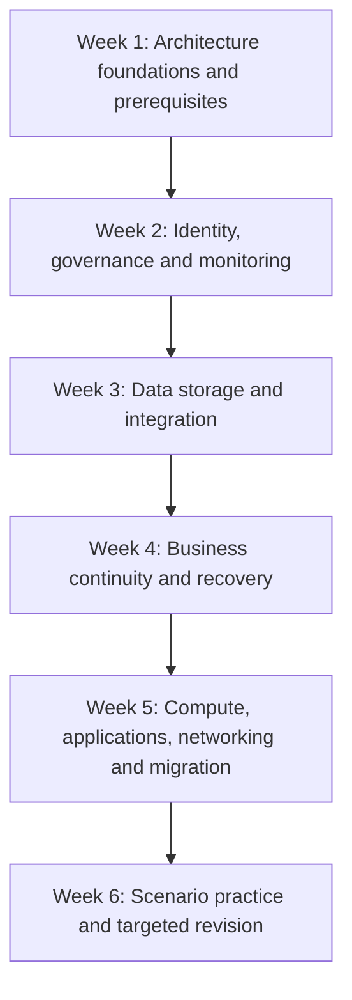
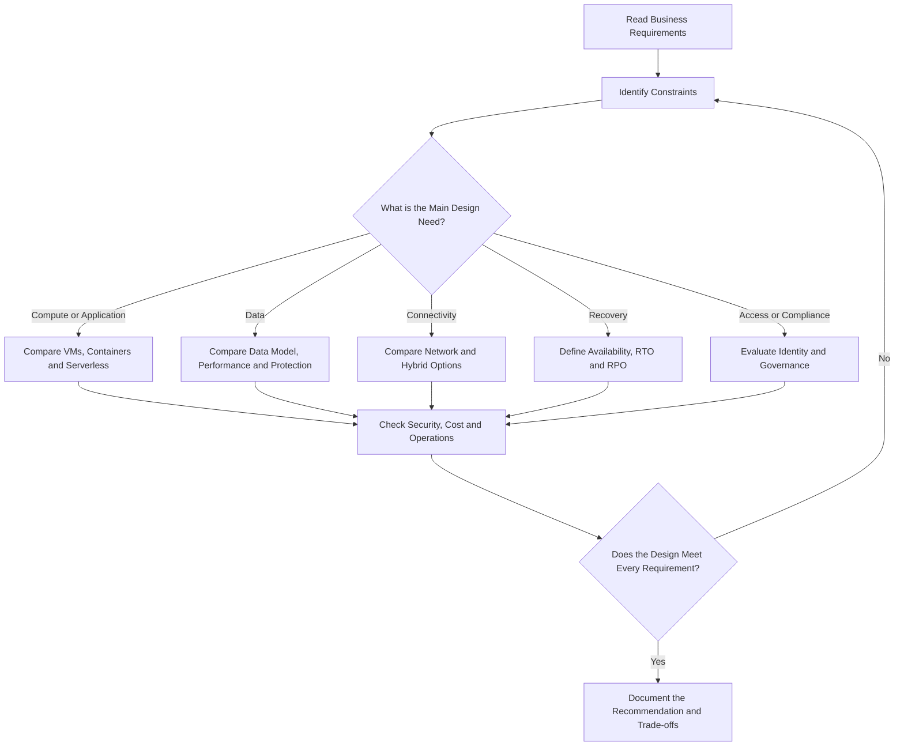

# Microsoft AZ-305: Designing Azure Infrastructure Solutions — Study Guide

A practical, community-driven study guide for the **Microsoft AZ-305: Designing Microsoft Azure Infrastructure Solutions** exam. This repository helps aspiring Azure solutions architects organize their preparation around architecture decisions, official exam objectives, scenario-based practice, and hands-on design exercises.

The focus is on choosing appropriate Azure services for real business requirements: security, scalability, availability, performance, governance, cost, migration, and recovery.

Use this guide alongside the [official Microsoft AZ-305 study guide](https://learn.microsoft.com/en-us/credentials/certifications/resources/study-guides/az-305), Microsoft Learn, and the Azure Architecture Center.

## Table of Contents

- [About AZ-305](#about-az-305)
- [Who Should Prepare?](#who-should-prepare)
- [Exam Information](#exam-information)
- [Official Exam Objectives](#official-exam-objectives)
- [Exam Domain Weightage](#exam-domain-weightage)
- [Azure Solution Architecture Overview](#azure-solution-architecture-overview)
- [How to Prepare for AZ-305](#how-to-prepare-for-az-305)
- [Certification Preparation Flowchart](#certification-preparation-flowchart)
- [Circular Study and Revision Cycle](#circular-study-and-revision-cycle)
- [Suggested Six-Week Roadmap](#suggested-six-week-roadmap)
- [Architecture Decision Framework](#architecture-decision-framework)
- [Hands-On Design Projects](#hands-on-design-projects)
- [AZ-305 Practice Questions](#az-305-practice-questions)
- [Common Preparation Mistakes](#common-preparation-mistakes)
- [Career Relevance](#career-relevance)
- [Frequently Asked Questions](#frequently-asked-questions)
- [Official and Additional Resources](#official-and-additional-resources)
- [About CertsGate](#about-certsgate)

---

## About AZ-305

**AZ-305: Designing Microsoft Azure Infrastructure Solutions** evaluates the ability to design cloud and hybrid solutions that run on Microsoft Azure.

Unlike an exam focused primarily on configuring individual resources, AZ-305 emphasizes architecture decisions. Candidates need to translate business and technical requirements into designs that balance security, availability, resilience, performance, operational needs, and cost.

The exam covers four principal areas:

- Identity, governance, and monitoring.
- Data storage.
- Business continuity.
- Infrastructure, including compute, application architecture, migration, and networking.

Microsoft positions this exam as part of the requirements for the **Microsoft Certified: Azure Solutions Architect Expert** certification.

Official links:

- [AZ-305 exam page](https://learn.microsoft.com/en-us/credentials/certifications/exams/az-305/)
- [Azure Solutions Architect Expert certification](https://learn.microsoft.com/en-us/credentials/certifications/azure-solutions-architect/)

## Who Should Prepare?

AZ-305 is intended for learners with experience designing and operating cloud or hybrid infrastructure. It is particularly relevant to:

- Azure administrators moving toward solution architecture.
- Cloud engineers responsible for infrastructure design.
- Infrastructure and enterprise architects working with Azure.
- Technical professionals who design migrations and disaster-recovery solutions.
- IT professionals who need to evaluate Azure services against business requirements.

Microsoft recommends advanced familiarity with networking, virtualization, identity, security, governance, data platforms, business continuity, and disaster recovery. Experience with Azure administration, development, and DevOps processes is also relevant.

If you need to strengthen your foundations first, start with the [AZ-305 architecture prerequisites learning path](https://learn.microsoft.com/en-us/training/paths/microsoft-azure-architect-design-prerequisites/).

---

## Exam Information

| Item | Details |
|---|---|
| Exam code | AZ-305 |
| Official exam title | Designing Microsoft Azure Infrastructure Solutions |
| Certification | Microsoft Certified: Azure Solutions Architect Expert |
| Role | Solution Architect |
| Main focus | Designing cloud and hybrid Azure solutions |
| Latest English skills-measured update referenced here | April 17, 2026 |
| Passing score | 700 or greater on Microsoft's 1–1000 scale |
| Question count | Not specified here; check current Microsoft exam information |
| Exam duration | Confirm the current duration on the official exam page |
| Retirement status | No retirement date listed on the official page when this guide was prepared |

Microsoft updates exams periodically. Question types, language availability, time allowances, and exam policies may change. Verify these details on the [official AZ-305 exam page](https://learn.microsoft.com/en-us/credentials/certifications/exams/az-305/) before booking.

### Certification prerequisite

Microsoft's Azure Solutions Architect Expert certification page states that candidates must earn the **Azure Administrator Associate** certification and pass AZ-305. Review the [official certification requirements](https://learn.microsoft.com/en-us/credentials/certifications/azure-solutions-architect/) for the current pathway.

---

## Official Exam Objectives

Microsoft's study guide organizes AZ-305 into four domains. Use the following sections as a starting checklist, then consult the official study guide for the detailed tasks and related documentation.

### 1. Design Identity, Governance, and Monitoring Solutions — 25–30%

This domain focuses on designing controls for access, compliance, and operational visibility.

Key areas include:

- Recommending authentication and identity-management solutions.
- Designing authorization for Azure and on-premises resources.
- Selecting approaches for secrets, certificates, and keys.
- Structuring management groups, subscriptions, and resource groups.
- Developing resource-tagging and compliance strategies.
- Designing identity governance.
- Selecting logging, log-routing, and monitoring solutions.

**Architecture question to practice:** How would you structure identity, permissions, logging, and governance for an organization with multiple subscriptions and both cloud and on-premises resources?

### 2. Design Data Storage Solutions — 20–25%

This domain is about matching data requirements to suitable storage technologies.

Key areas include:

- Selecting relational database services.
- Choosing database service and compute tiers.
- Designing database scalability and data protection.
- Selecting storage for semi-structured and unstructured data.
- Balancing storage features, performance, durability, and cost.
- Designing data integration and data-analysis solutions.

**Architecture question to practice:** How would you select a data platform for a workload that needs transactional consistency, predictable performance, scalable storage, and a defined recovery strategy?

### 3. Design Business Continuity Solutions — 15–20%

Business continuity requires designs that remain available or can recover within agreed business limits.

Key areas include:

- Designing recovery for Azure and hybrid workloads.
- Selecting backup and recovery solutions for compute.
- Designing database backup and recovery.
- Protecting unstructured data.
- Designing high availability for compute.
- Designing high availability for relational, semi-structured, and unstructured data.

**Architecture question to practice:** What design would satisfy a stated recovery time objective (RTO) and recovery point objective (RPO) without introducing unnecessary cost or complexity?

### 4. Design Infrastructure Solutions — 30–35%

This domain covers a broad set of infrastructure and application architecture decisions.

Key areas include:

- Selecting VM-based, container-based, serverless, and batch-compute approaches.
- Designing messaging, event-driven, API-integration, and caching solutions.
- Managing application configuration and automated deployment.
- Evaluating migration approaches for servers, applications, databases, and unstructured data.
- Designing internet and hybrid connectivity.
- Optimizing network performance and security.
- Selecting load-balancing and routing solutions.

**Architecture question to practice:** Given workload constraints, how would you choose a compute model, integration pattern, network design, and migration approach that work together?

**Source:** [Microsoft AZ-305 Study Guide](https://learn.microsoft.com/en-us/credentials/certifications/resources/study-guides/az-305)

---

## Exam Domain Weightage

The percentages below are the published ranges in Microsoft's study guide.

**Important:** The pie chart uses the midpoint of each official range solely to provide a visual comparison. These midpoint values are not official fixed percentages or a prediction of the exact exam distribution.

| Official domain | Published weight range |
|---|---:|
| Design identity, governance, and monitoring solutions | 25–30% |
| Design data storage solutions | 20–25% |
| Design business continuity solutions | 15–20% |
| Design infrastructure solutions | 30–35% |

The infrastructure domain has the largest published range, but preparation should cover all four domains. A design question may combine several areas—for example, identity, networking, monitoring, and disaster recovery in the same scenario.

---

## Azure Solution Architecture Overview

The following diagram is a **conceptual learning architecture**, not a required reference architecture or an official exam blueprint. It illustrates how common design concerns interact.

### What the diagram teaches

A solution architect should not select each service in isolation. A compute decision affects network requirements, identity controls, monitoring, deployment, cost, and recovery. Likewise, a database choice influences performance, scalability, availability, and backup design.

A good AZ-305 answer explains how the proposed design meets the stated requirements while avoiding unnecessary services or operational overhead.

### Architecture principles to review

- **Security:** Apply least privilege, protect secrets, and use suitable network controls.
- **Reliability:** Design for the required availability and recovery behavior.
- **Performance efficiency:** Match compute, storage, and network choices to workload characteristics.
- **Cost optimization:** Compare service tiers and operational costs against actual requirements.
- **Operational excellence:** Include monitoring, deployment, maintenance, and incident response.
- **Governance:** Make access, compliance, and resource organization explicit.

Use the [Azure Well-Architected Framework](https://learn.microsoft.com/en-us/azure/well-architected/) and [Azure Architecture Center](https://learn.microsoft.com/en-us/azure/architecture/) to explore these ideas in detail.

---

## How to Prepare for AZ-305

### Step 1: Read the current exam objectives

Start with Microsoft's [official study guide](https://learn.microsoft.com/en-us/credentials/certifications/resources/study-guides/az-305). Convert each listed skill into a checklist and identify which areas you can explain confidently, which need study, and which require more practical experience.

### Step 2: Learn to reason from requirements

Architecture questions often describe a business problem rather than ask for a definition. Extract the important constraints before choosing a service.

Look for:

- Availability and recovery requirements.
- Data type, consistency, and performance needs.
- Security and identity constraints.
- Existing infrastructure and migration limitations.
- Network connectivity requirements.
- Cost and operational constraints.

Then eliminate solutions that fail a stated requirement, even if they are technically possible.

### Step 3: Compare services and design trade-offs

Build comparison notes for related options. For example, compare compute models by control, scaling, management overhead, and workload fit. Compare data services by data model, consistency, availability, performance, and cost.

Avoid memorizing product names without understanding when each service is appropriate.

### Step 4: Practice with architecture scenarios

Use case studies and practice questions to test whether you can choose a design and justify it. After each attempt, review the relevant official objective and documentation.

Supplementary resources such as the [CertsGate AZ-305 preparation page](https://certsgate.com/exams/microsoft/az-305) can provide additional opportunities to review concepts. Treat third-party questions as learning aids, not as proof that the same questions will appear on the exam.

### Step 5: Validate designs with practical work

Where possible, implement small prototypes or architecture exercises. For example, deploy a test workload, configure monitoring, examine network paths, or compare backup and recovery options.

The goal is not to build every possible Azure architecture. It is to understand the implications of the choices you recommend.

### Step 6: Revisit weak areas

For each incorrect or uncertain answer:

1. Identify the requirement you overlooked.
2. Map the mistake to an official objective.
3. Research the relevant service or design pattern.
4. Write down why the correct choice fits.
5. Explain why the alternatives are less suitable.
6. Revisit the scenario later without looking at the answer.

---

## Certification Preparation Flowchart

This workflow helps structure the AZ-305 study process. If important design gaps remain, return to targeted study before the next readiness check.

## Circular Study and Revision Cycle

Architecture knowledge improves through repeated comparison, application, and review. Use this cycle throughout preparation instead of treating each topic as complete after a single reading.

Return to a topic if you can recognize the correct answer but cannot explain why it is appropriate, identify its trade-offs, or apply the same principle to a different workload.

---

## Suggested Six-Week Roadmap

This is an independent study plan, not a Microsoft-prescribed schedule. Adjust it based on your existing Azure experience and assessment results.

| Week | Study focus | Suggested outcome |
|---|---|---|
| 1 | Azure architecture fundamentals, Well-Architected Framework, Cloud Adoption Framework | Explain how business requirements shape architecture |
| 2 | Identity, governance, logging, monitoring, secrets, and compliance | Recommend suitable access and operational controls |
| 3 | Relational, semi-structured, and unstructured storage; data integration and analysis | Compare data solutions against workload needs |
| 4 | Backup, recovery, high availability, RTO, and RPO | Match continuity designs to recovery requirements |
| 5 | Compute, application architecture, migration, connectivity, routing, and network security | Build end-to-end designs and explain trade-offs |
| 6 | Practice assessments, case studies, weak-domain review, final checklist | Identify gaps and assess readiness |

Reserve some time each week to revisit earlier topics. AZ-305 scenarios can combine domains, so isolated memorization is not enough.

---

## Architecture Decision Framework

Use this decision process when working through practice scenarios. The diagram is an independent study aid, not an official Microsoft decision tree.

### Example: Selecting a compute approach

| Requirement to investigate | Design consideration |
|---|---|
| Need for operating-system-level control | Evaluate virtual machines |
| Containerized applications and orchestration needs | Evaluate container services |
| Event-triggered code with limited infrastructure management | Evaluate serverless options |
| Large scheduled or parallel processing workloads | Evaluate batch-processing options |
| Need for high availability | Assess redundancy, deployment topology, and failure scenarios |
| Need for cost control | Compare service pricing and resource utilization under expected load |

These are starting points, not automatic answers. A scenario's specific requirements determine which option is appropriate.

### Example: Designing continuity

Before recommending a recovery solution, establish:

- **RTO:** How long the business can tolerate an outage.
- **RPO:** How much data loss, measured in time, can be tolerated.
- Workload dependencies and recovery order.
- Backup retention and restore requirements.
- Regional or zonal failure assumptions.
- Testing, operational ownership, and recovery costs.

A solution that offers backups may not, by itself, satisfy a requirement for rapid failover. The design must address the actual recovery objective.

---

## Hands-On Design Projects

These projects are independent study exercises designed to reinforce architecture reasoning. They are not official Microsoft labs or exam questions.

### Project 1: Secure multi-subscription environment

**Scenario:** An organization has several teams with different access needs and wants consistent governance.

**Tasks**
- Sketch a management-group, subscription, and resource-group structure.
- Define a role-assignment approach using least privilege.
- Identify where policy and tagging should apply.
- Select a strategy for secrets, certificates, and keys.
- Recommend how logs should be collected and routed.

**Deliverable:** A diagram plus a short explanation of access scope, compliance, monitoring, and trade-offs.

### Project 2: Data platform design

**Scenario:** An application uses relational business records and stores semi-structured events and unstructured files.

**Tasks**
- Identify the data access patterns and consistency needs.
- Compare candidate storage services.
- Consider performance, scalability, protection, durability, and cost.
- Describe the data integration and analysis requirements.
- Document the assumptions that would change your recommendation.

**Deliverable:** A service comparison table and a proposed data architecture.

### Project 3: Business continuity plan

**Scenario:** A business-critical workload must recover after infrastructure or regional disruption.

**Tasks**
- Define RTO and RPO.
- Identify compute, database, and file-data dependencies.
- Compare backup, restore, replication, and high-availability approaches.
- Identify failure scenarios and testing requirements.
- Estimate the operational trade-offs of the proposed design.

**Deliverable:** A recovery flowchart, recovery assumptions, and a concise design rationale.

### Project 4: Application modernization and migration

**Scenario:** An organization needs to migrate an existing application to Azure.

**Tasks**
- Inventory servers, application dependencies, and data.
- Decide whether the workload is best suited to IaaS, PaaS, containers, or serverless components.
- Design network connectivity and identity.
- Select an API, messaging, or event-driven integration pattern where appropriate.
- Propose deployment automation, monitoring, and migration validation.

**Deliverable:** A target architecture diagram and a migration decision summary.

### Project 5: Architecture review

Select one of the designs above and evaluate it against the Azure Well-Architected Framework pillars.

Document:
- Security risks and mitigations.
- Reliability and recovery behavior.
- Performance constraints.
- Cost considerations.
- Operational monitoring and maintenance.

This final review develops the habit of defending an architecture decision rather than simply naming Azure services.

---

## AZ-305 Practice Questions

The questions below are **original illustrative study questions** created for this repository. They are not official Microsoft exam questions and are not represented as actual exam content.

### Question 1: Identity and governance

An organization needs to manage Azure resources across multiple subscriptions while applying consistent governance. Which design elements should be considered?

A. Resource tags alone  
B. Management groups, subscription organization, policy, and appropriate access controls  
C. A separate storage account for every user  
D. Disabling resource monitoring  

**Answer: B**

**Explanation:** The design should consider resource hierarchy, compliance, and access requirements together. Tags can help organize resources but do not replace policy or authorization.

### Question 2: Data storage

A workload stores structured transactional records and requires a relational data model. What should guide the storage recommendation?

A. Only the number of files  
B. Data model, consistency, performance, scalability, availability, protection, and cost requirements  
C. The default service selected in the portal  
D. Whether the application has a virtual machine  

**Answer: B**

**Explanation:** A suitable relational data solution depends on workload characteristics and operational requirements, not a single unrelated factor.

### Question 3: Business continuity

A business defines a strict recovery time objective and a limited recovery point objective. What should an architect do first?

A. Select the least expensive storage option immediately  
B. Translate the recovery objectives into a design for availability, backup, replication, and recovery testing  
C. Increase resource tags  
D. Disable monitoring to reduce overhead  

**Answer: B**

**Explanation:** RTO and RPO describe business recovery requirements. The architecture must be evaluated against them, including dependencies and tested recovery procedures.

### Question 4: Application architecture

An application needs loosely coupled components that communicate through messages. Which design approach should be investigated?

A. Messaging architecture  
B. Resource tagging only  
C. A backup retention policy only  
D. A management-group hierarchy only  

**Answer: A**

**Explanation:** Messaging can help decouple components. The specific service and pattern should be selected based on delivery semantics, throughput, ordering, reliability, and other requirements.

### Question 5: Migration planning

Before recommending a migration path for an on-premises application, what should an architect investigate?

A. Only the application's current server name  
B. Dependencies, application and data requirements, compatibility, networking, security, and business constraints  
C. Only the number of resource groups  
D. Whether a newer service exists  

**Answer: B**

**Explanation:** Migration design depends on the workload's dependencies and constraints. A service being newer does not automatically make it the best destination.

### How to use practice questions effectively

After each answer:

1. Identify the relevant official objective.
2. Explain why the selected option fits the scenario.
3. Explain why the alternatives fail to meet the requirements.
4. Review relevant Microsoft documentation.
5. Change one requirement and consider whether the recommendation would change.
6. Revisit the concept later to test retention.

Use Microsoft's [official AZ-305 exam page](https://learn.microsoft.com/en-us/credentials/certifications/exams/az-305/) to access its free practice assessment and exam sandbox. Use third-party materials as supplements, not replacements for official objectives and design reasoning.

---

## Common Preparation Mistakes

### Memorizing service names without understanding trade-offs

AZ-305 preparation requires choosing between viable options. Learn the requirements that make one design preferable to another.

### Ignoring the business constraints

A technically powerful solution may be inappropriate if it exceeds the budget, adds unnecessary operational work, or fails a recovery requirement.

### Treating all storage as equivalent

Relational, semi-structured, and unstructured data can have different access patterns, consistency requirements, performance needs, and protection options.

### Confusing backup with high availability

Backups help recover data or workloads; high availability aims to maintain service through defined failures. Some designs need both.

### Overlooking identity and governance

Architecture includes who can access resources, how compliance is enforced, how secrets are managed, and how operations are monitored.

### Skipping migration dependencies

Moving a server is not the same as migrating a working application. Identity, data, network paths, integrations, and operational processes must also be considered.

### Using practice scores as a guarantee

Assessment results help identify gaps, but they do not guarantee an exam result. Review incorrect answers and make sure you can defend your choices in new scenarios.

---

## Career Relevance

AZ-305 supports learning for cloud and infrastructure architecture roles. Its domains reflect responsibilities such as translating requirements into designs, selecting services, evaluating trade-offs, planning migration, and designing security and continuity controls.

These skills can be useful to:

- Azure solutions architects.
- Cloud infrastructure architects.
- Senior cloud engineers.
- Infrastructure modernization specialists.
- Technical consultants working on Azure adoption and migration.

Certification is one way to demonstrate knowledge. Employers may also assess real-world design experience, communication, risk analysis, cost awareness, and the ability to explain why a proposed solution fits a business need.

---

## Frequently Asked Questions

### What is the AZ-305 exam?

AZ-305 is Microsoft's *Designing Microsoft Azure Infrastructure Solutions* exam. It assesses architecture design skills across identity and governance, storage, business continuity, and infrastructure.

### What is the passing score?

Microsoft lists a passing score of **700 or greater** on its 1–1000 scale. Check the [official AZ-305 page](https://learn.microsoft.com/en-us/credentials/certifications/exams/az-305/) for current details.

### What certification is associated with AZ-305?

AZ-305 is part of the requirements for Microsoft Certified: Azure Solutions Architect Expert. Microsoft's current certification page also lists Azure Administrator Associate as a prerequisite certification. Review the [official certification requirements](https://learn.microsoft.com/en-us/credentials/certifications/azure-solutions-architect/).

### How long should I study for AZ-305?

There is no universal preparation duration. Your timeline depends on Azure experience, architecture knowledge, available study time, and performance against the official objectives. Use the roadmap in this repository as a starting point, not a guarantee.

### Is AZ-305 mainly a configuration exam?

Its focus is designing Azure infrastructure solutions. Practical experience remains valuable because it helps you understand how services behave, but preparation should emphasize selecting and justifying designs against stated requirements.

### Are third-party AZ-305 practice questions enough?

No single question bank should be your only preparation source. Use official Microsoft objectives, technical documentation, learning paths, the official practice assessment, and design exercises alongside supplementary materials.

### How can I assess readiness?

You should be able to explain the current objectives, compare relevant Azure services, solve unfamiliar architecture scenarios, justify trade-offs, and identify why alternative designs fail the requirements. No readiness method guarantees a passing result.

### Does the certification need renewal?

Microsoft role-based and specialty certifications generally require periodic renewal. Check the current [Azure Solutions Architect Expert certification page](https://learn.microsoft.com/en-us/credentials/certifications/azure-solutions-architect/) for the applicable renewal process.

---

## Official and Additional Resources

Start with Microsoft's official resources and use them to validate any external study material.

| Resource | Purpose |
|---|---|
| [AZ-305 Exam Page](https://learn.microsoft.com/en-us/credentials/certifications/exams/az-305/) | Current exam details, languages, passing score, and practice assessment |
| [AZ-305 Study Guide](https://learn.microsoft.com/en-us/credentials/certifications/resources/study-guides/az-305) | Skills measured, detailed objectives, and linked documentation |
| [Azure Solutions Architect Expert](https://learn.microsoft.com/en-us/credentials/certifications/azure-solutions-architect/) | Certification requirements and renewal information |
| [AZ-305 Prerequisites Learning Path](https://learn.microsoft.com/en-us/training/paths/microsoft-azure-architect-design-prerequisites/) | Review Azure architecture foundations |
| [Microsoft Learn: Azure](https://learn.microsoft.com/en-us/training/azure/) | Self-paced Azure training |
| [Azure Architecture Center](https://learn.microsoft.com/en-us/azure/architecture/) | Reference architectures and design guidance |
| [Azure Well-Architected Framework](https://learn.microsoft.com/en-us/azure/well-architected/) | Review security, reliability, performance, cost, and operational considerations |
| [Azure Documentation](https://learn.microsoft.com/en-us/azure/) | Official service documentation |
| [Azure Architecture Blog and Updates](https://azure.microsoft.com/en-us/blog/) | Follow Azure announcements and technical updates |
| [CertsGate AZ-305 Page](https://certsgate.com/exams/microsoft/az-305) | Supplementary certification preparation resource |

Service recommendations can change as Azure evolves. Confirm important architecture decisions against current documentation, availability, limitations, and pricing.

---

## About CertsGate

[CertsGate](https://certsgate.com/) provides supplementary IT certification preparation resources. Learners studying for AZ-305 can explore the [CertsGate AZ-305 page](https://certsgate.com/exams/microsoft/az-305) as an additional way to review concepts and check their understanding.

Use third-party practice resources alongside Microsoft's official exam objectives, Azure documentation, and practical design work. Evaluate supplementary material against the current exam version and focus on understanding the reasoning behind each answer.
